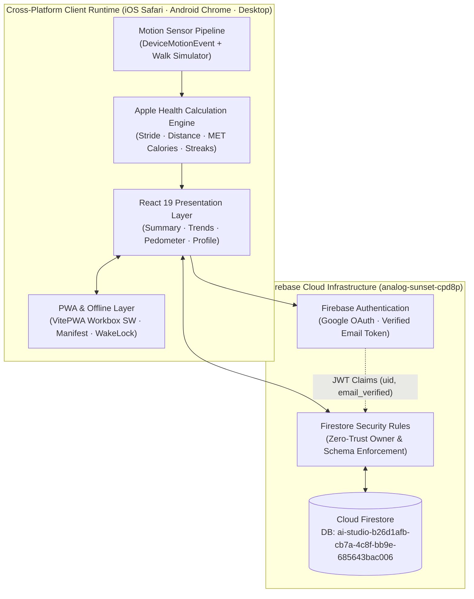

# High-Level Architecture

## 1. Architectural Overview

StridePulse is designed as a **serverless, offline-capable Progressive Web App (PWA)** backed by **Firebase Authentication** and **Cloud Firestore**. Every user device—iPhone, Android phone, or desktop browser—runs the same React + TypeScript client bundle, reads hardware motion sensors locally when available, computes Apple Health-equivalent biometric metrics on-device, and syncs aggregated daily records and individual sessions directly to the user's private Firestore partition.



---

## 2. System Layers

### A. Presentation & Navigation Layer (`src/components/`, `src/App.tsx`)
- **Adaptive Responsive Shell**:
  - **Desktop (`>= 1024px`)**: 3-zone sticky top navigation bar (`StridePulse` — `Summary / Trends / Pedometer / Profile` — `Log Walk` CTA) with multi-column grid layouts.
  - **Mobile (`< 1024px`, iOS & Android)**: Compact sticky header + thumb-zone **Fixed Bottom Tab Bar** (`44×44px` minimum touch targets, `env(safe-area-inset-bottom)` safe-area padding) and slide-up bottom-sheet modals.
- **Dual-Theme Support**: Uses Tailwind CSS v4 `@custom-variant dark` toggled via `.dark` on `document.documentElement` and persisted in `localStorage`.

### B. Device Sensor & PWA Runtime Layer (`src/hooks/`, `vite.config.ts`)
- **Cross-Platform Accelerometer Hook (`useStepSensor.ts`)**: Bridges Android's direct `DeviceMotionEvent` stream and iOS Safari's permission-gated `DeviceMotionEvent.requestPermission()` API behind one unified state machine.
- **Screen Wake Lock**: Acquires `navigator.wakeLock` during active pedometer sessions on supported mobile browsers so tracking is not interrupted by screen dimming.
- **Workbox Service Worker**: Precaches application shell assets (`js`, `css`, `html`, `png`, `svg`) and caches Google Fonts for instant cold launch and offline resilience.

### C. Domain Calculation Layer (`src/lib/healthCalculations.ts`)
- Pure, deterministic functions converting raw step counts + user biometrics (`heightCm`, `weightKg`, `strideLengthCm`) into distance, active calories, active minutes, flights climbed, streaks, and Apple Health `export.xml` / CSV transformations.

### D. Persistence & Security Layer (`src/lib/firebase.ts`, `src/services/firestoreSteps.ts`, `firestore.rules`)
- **Zero-Backend Client-to-Firestore Architecture**: Authenticated clients interact directly with Cloud Firestore using the Firebase Web SDK configured against the named database `ai-studio-b26d1afb-cb7a-4c8f-bb9e-685643bac006`.
- **Multi-Tenant Isolation**: All user data lives strictly under `/users/{userId}` and its subcollections (`dailySteps`, `stepSessions`). Every read, list, create, update, and delete is gated by `firestore.rules` verifying `request.auth.uid == userId` and `request.auth.token.email_verified == true`.

---

## 3. Data Partitioning Strategy

```text
/users/{userId}                        # Profile & biometric calibration (private to owner)
  ├── /dailySteps/{YYYY-MM-DD}         # Pre-aggregated daily total + 24-hour array
  └── /stepSessions/{sessionId}        # Immutable log of walks, sensor runs, and imports
```

This 2-tier subcollection layout ensures:
1. **O(1) Daily Dashboard Reads**: Rendering a week, month, or year of trends only reads 7–365 compact `dailySteps` documents instead of scanning thousands of raw step events.
2. **Auditability & Undo**: Every manual log or pedometer capture creates an entry in `stepSessions`, allowing users to inspect or delete individual walks while keeping the parent daily record synchronized.
