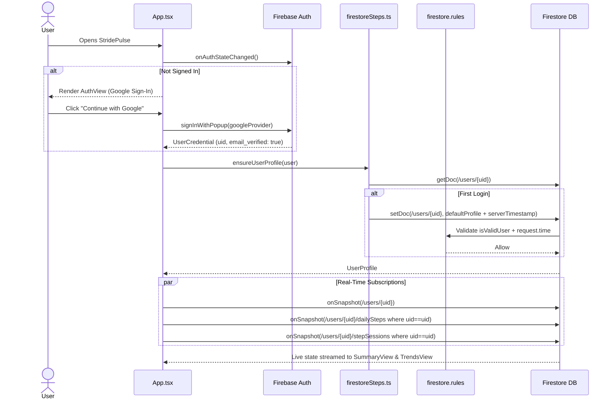
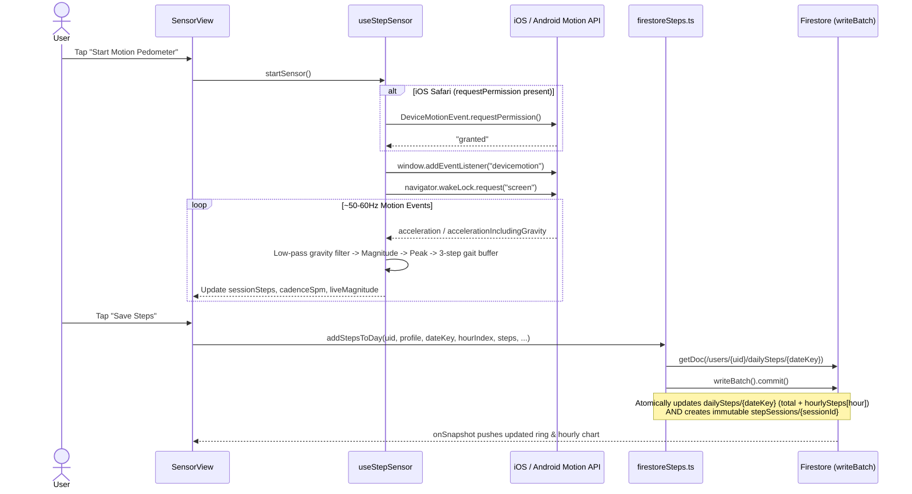
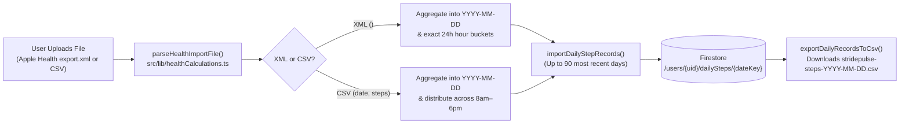
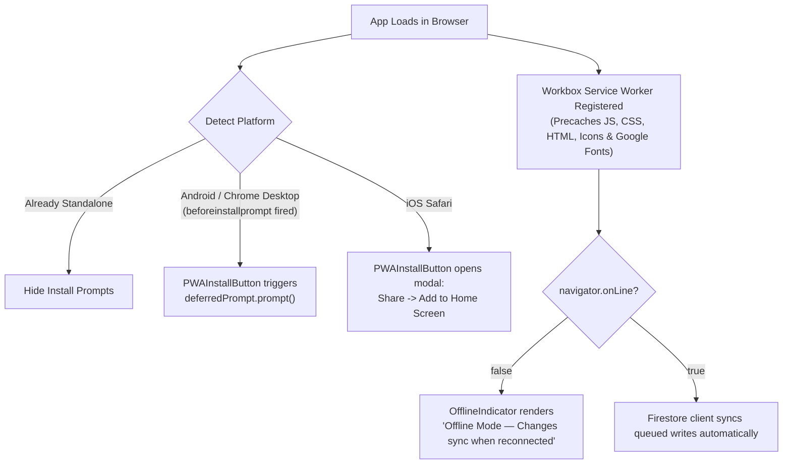

# Architecture & Data Flows

## 1. Authentication & Cloud Sync Bootstrap

---

## 2. Live Pedometer Capture & Atomic Write Flow

---

## 3. Apple Health XML / CSV Import & CSV Export Flow

---

## 4. Cross-Platform PWA Installability & Offline Flow

